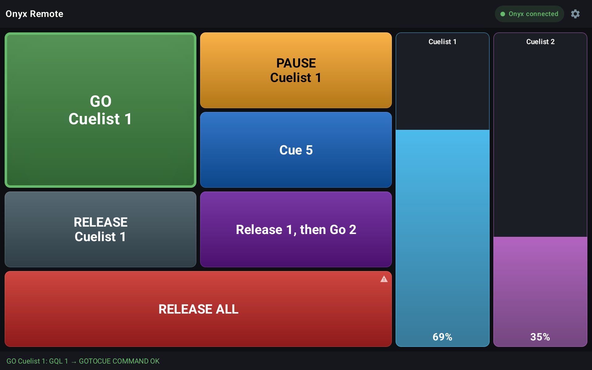
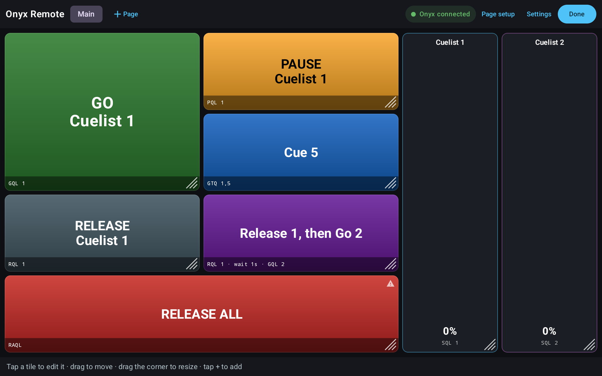
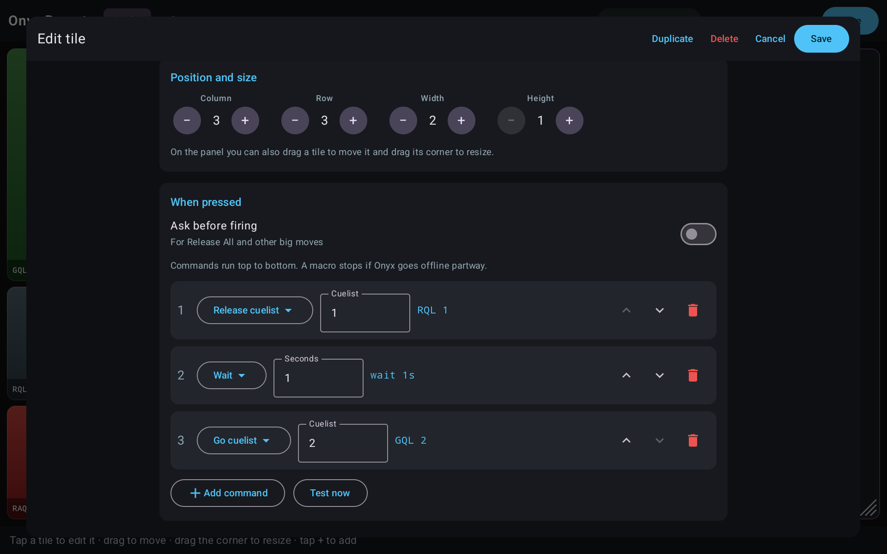
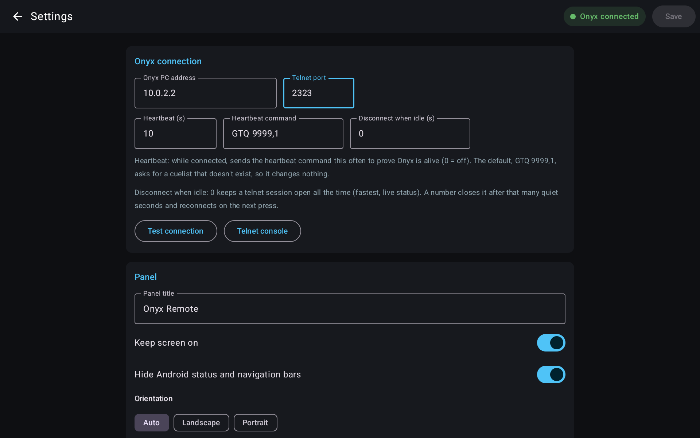

# Onyx Remote (Android)

A tablet panel for Onyx: pages of buttons and faders you lay out yourself,
like Onyx Manager on Windows. It drives Onyx over the telnet remote described
in [docs/ONYX_TELNET_REFERENCE.md](docs/ONYX_TELNET_REFERENCE.md), so every
press gets a confirmed answer from the console.

There is no official Onyx remote for Android; this fills that gap for
wall-mounted or handheld tablets.



**Install:** download the APK from [Releases](../../releases) (Android 8.0+). Sideload it with
`adb install`, or copy it to the tablet and open it (allow "install unknown
apps" for the file manager when asked).

## What a tile can do

| Tile | Does |
|---|---|
| **Button** | Runs a list of commands top to bottom. Optionally asks for confirmation first (⚠ on the tile). |
| **Fader** | Sets a cuelist level (`SQL n,0-255`) as you drag. Relative drag, so a stray touch can't jump the level. |
| **Label** | A heading. Sends nothing. |

Button commands: Go cuelist (`GQL`), Go to cue (`GTQ`), Pause (`PQL`),
Release (`RQL`), Set level (`SQL`), Release all and its dimmer-first /
overrides variants (`RAQL`, `RAQLDF`, `RAO`, `RAQLO`, `RAQLODF`), Clear
programmer (`CLRCLR`), Wait n seconds, and Raw (any telnet line).

After a press the tile outlines **green** when Onyx says `COMMAND OK`, **red**
otherwise, and the strip at the bottom says exactly what Onyx answered —
including `Cuelist Not Found`, which Onyx reports with a `200 Ok` code.

## Setting up a tablet

1. Install and open the app. Tap ⚙ (top right) to enter **edit mode**.
2. **Settings** → Onyx PC address and telnet port (23 by default),
   then **Test connection**. The pill at the top turns green when connected.
3. Set an **Edit PIN** so guests and staff can't rearrange the panel.
4. Back on the panel (still in edit mode): tap **+** in a cell to add a tile,
   tap a tile to edit it, drag a tile to move it, drag its corner to resize.
   **Page setup** sets the grid size (up to 12×12); **+ Page** adds a page.
5. Tap **Done**.

| Edit mode | Tile editor |
|---|---|
|  |  |



The screenshots were taken on an emulator against `tools/onyx_telnet_sim.py`,
which is why the address is `10.0.2.2:2323`.

Back never leaves the panel. The app can also be chosen as the tablet's Home
app (Android asks the first time you press Home), which keeps it in front
after a reboot. Settings has an **Open Android settings** button so you can
always get out again.

## Many tablets, one layout

- **Export / Import** (Settings → Backup and transfer) moves a `.json` layout
  between tablets. Import offers *Layout only* (keep this tablet's
  connection, PIN and display settings) or *Everything*.
- **Shared layout URL**: put the exported file on any http server on the
  show LAN, enter its URL on each tablet and turn on *Sync when the app
  starts*. Edit once, and every tablet picks it up on its next launch (or
  **Sync now**). Only the title and pages are taken from the file.

## Connection behaviour

- **Stays connected** by default and sends a heartbeat (`GTQ 9999,1`, a
  cuelist that can't exist, so it changes nothing) every 10 s. A dead link
  shows red within seconds and reconnects on its own.
- **Presses are never queued.** If Onyx is unreachable the press fails
  immediately and says why. A cue that fires a minute late is worse than one
  that visibly doesn't.
- A macro stops at the first step Onyx doesn't answer, rather than firing the
  rest out of order.
- **Disconnect when idle** (seconds) switches to connect-per-press, for the
  case where Onyx turns out to limit telnet sessions (see below).
- **Telnet console** (Settings) sends any line and shows the raw reply —
  useful for `help` after an Onyx upgrade.

## ⚠️ Check before deploying

- **Concurrent telnet sessions are not verified.** If something else (a show
  controller, another remote) already holds a telnet session, confirm on the
  real console that Onyx accepts several clients at once and that the other
  controller is unaffected with every tablet connected. If Onyx limits sessions, set
  *Disconnect when idle* on the tablets so they hold the link only briefly.
- **Telnet has no authentication**, so anything on the lighting VLAN can
  drive Onyx — put the tablets' Wi-Fi on a network that can reach only the
  Onyx PC, not the guest network.
- Onyx can't report a cuelist's level, so a fader shows the last level *this
  tablet* sent; it won't follow changes made elsewhere.

## Bench testing without the console

```bash
python3 tools/onyx_telnet_sim.py            # listens on :2323
```

Point the app at this machine, port 2323 (an emulator reaches the host as
`10.0.2.2`). It answers like the real console and prints every command.

## Building

Needs JDK 17 and the Android SDK (`brew install openjdk@17` and
`brew install --cask android-commandlinetools`, then `sdkmanager
"platforms;android-35" "build-tools;35.0.0"`). Put `sdk.dir=…` in
`local.properties`.

```bash
./gradlew testDebugUnitTest   # protocol + layout tests against a fake Onyx
./gradlew assembleRelease     # app/build/outputs/apk/release/app-release.apk
```

Release builds are signed with the key named in `keystore.properties` at the
project root (gitignored, along with `keystore/`); without it they fall back to
the debug key. Example:

```properties
storeFile=keystore/onyxremote-release.jks
storePassword=…
keyAlias=onyxremote
keyPassword=…
```

Create a key with `keytool -genkeypair -keystore keystore/onyxremote-release.jks -alias onyxremote -keyalg RSA -keysize 4096 -validity 36500`. **Back them up**: Android only
installs an update over an existing copy if it's signed with the same key, so
losing the key means uninstalling the app from every tablet (and losing their
layouts) to upgrade. Bump `versionCode` in `app/build.gradle.kts` for each
release.

## Code map

```
app/src/main/java/com/gsb/onyxremote/
  net/OnyxClient.kt     telnet session, reply parsing, heartbeat, reconnect
  model/Config.kt       pages, tiles, commands, JSON format, first-run layout
  RemoteViewModel.kt    firing, faders, editing, import/export/sync
  ConfigStore.kt        config.json in app storage
  ui/PanelScreen.kt     the panel, grid editing, PIN, page setup
  ui/TileEditor.kt      tile and command editor
  ui/SettingsScreen.kt  settings, backup, sync
  ui/ConsoleScreen.kt   raw telnet console
docs/ONYX_TELNET_REFERENCE.md   the Onyx telnet protocol, as observed on a console
tools/onyx_telnet_sim.py        stand-in Onyx for bench testing
```

## License

[MIT](LICENSE). Onyx and Obsidian Control Systems are trademarks of their
owners; this project is not affiliated with or endorsed by them.
